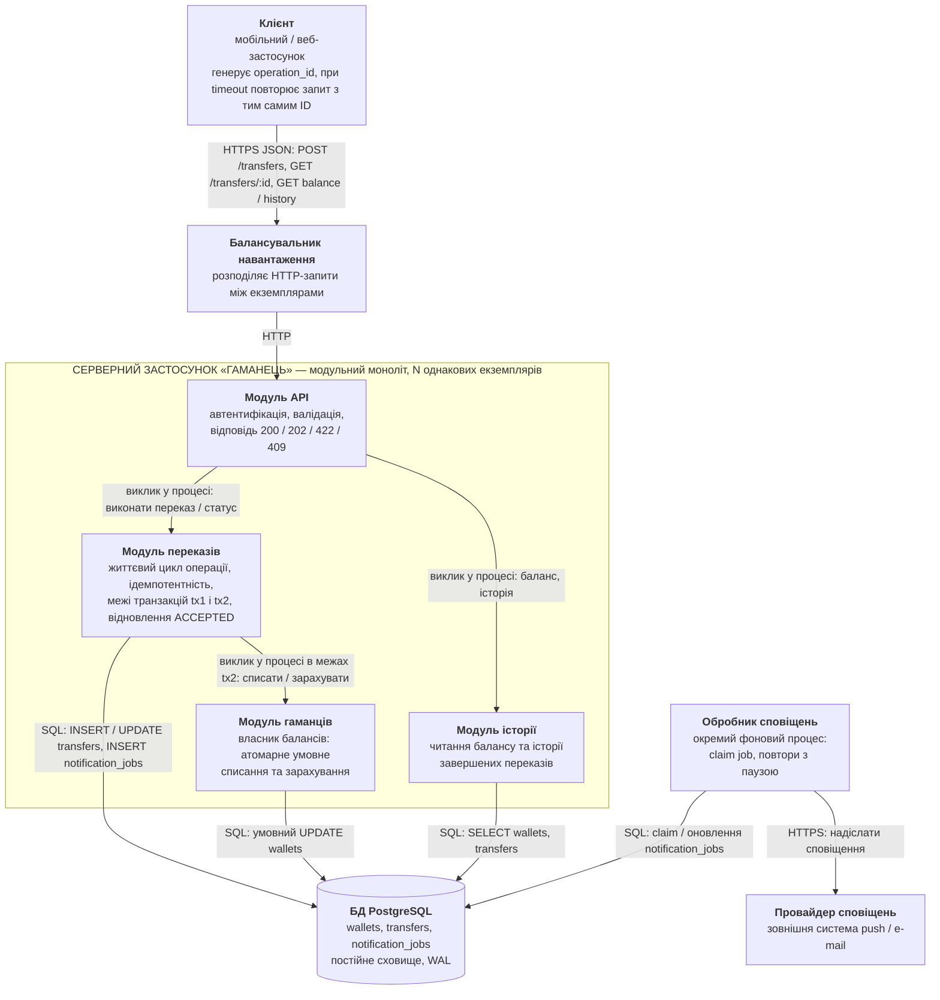
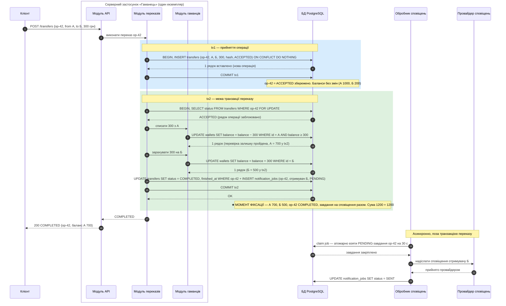
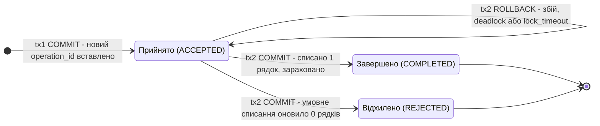
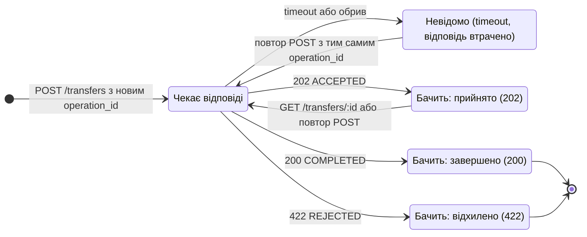
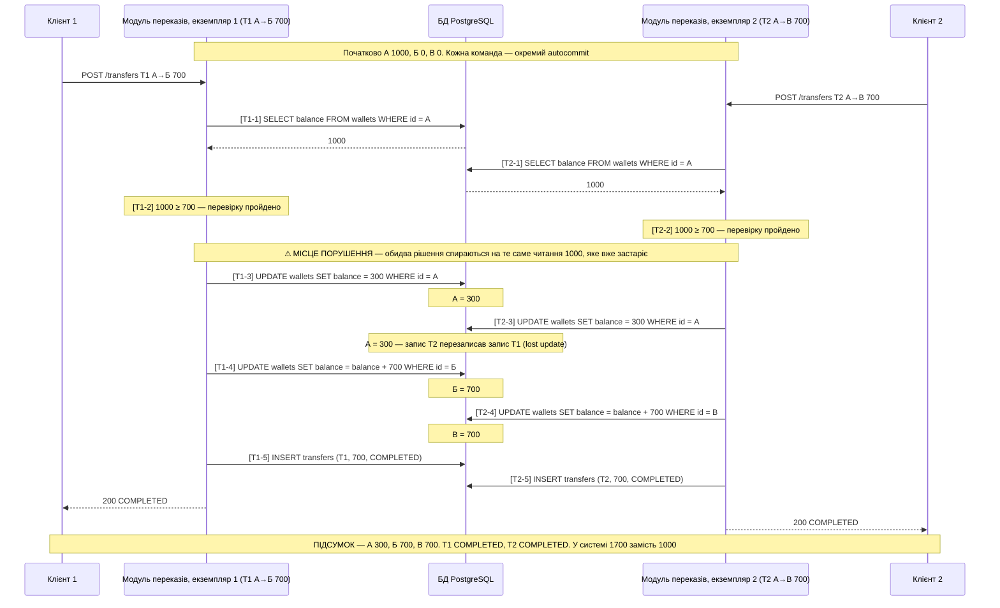
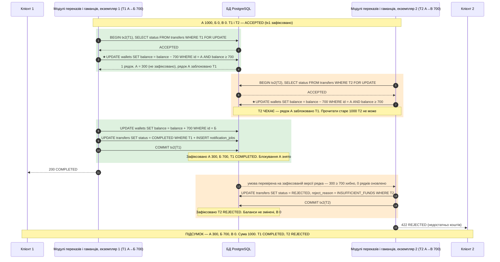

# Практична робота 1. Моделювання грошового переказу

## 0. Вибір архітектурного варіанта

В**аріант А — модульний моноліт зі спільною реляційною БД (PostgreSQL).**

Обґрунтування з урахуванням команди та строку:

- **Команда (6 розробників) має досвід веброзробки та реляційних БД, але не розподілених систем.** У моноліті правильність переказу забезпечує ACID-транзакція БД — механізм, який команда знає. У варіанті Б довелося б проєктувати мережевий протокол між сервісами, узгодження статусів після timeout і компенсації — саме той досвід, якого бракує.
- **3 місяці до першої версії.** Один застосунок, одна БД, один конвеєр розгортання. Модулі мають чіткі межі (гаманці / перекази / історія), тож за потреби їх можна виділити в сервіси пізніше.
- **Правила 1–4 природно лягають на одну БД:** списання, зарахування, запис переказу та завдання на сповіщення фіксуються одним `COMMIT`.
- **Горизонтальне масштабування** — кілька однакових екземплярів за балансувальником. Саме тому T1 і T2 можуть оброблятися в різних процесах, і захист має бути в БД, а не в пам’яті застосунку.

### Ключові проєктні рішення (спільні для всіх моделей)

| Рішення | Зміст |
| --- | --- |
| Ідентифікатор операції | Клієнт генерує `operation_id` (UUID) один раз для переказу й надсилає той самий ID при кожному повторі |
| Гроші | Цілі числа в копійках (`BIGINT`), одна валюта |
| Дві транзакції на переказ | **tx1** — фіксує прийняття (`ACCEPTED`) з `operation_id`; **tx2** — списання + зарахування + `COMPLETED`/`REJECTED` + завдання на сповіщення |
| Захист балансу | Атомарне умовне оновлення `UPDATE wallets SET balance = balance − :amount WHERE id = :sender AND balance >= :amount` (бере row lock на рядок відправника) + `CHECK (balance >= 0)` як друга лінія захисту |
| Ідемпотентність | `transfers.operation_id` — первинний ключ (UNIQUE); повтор повертає збережений результат |
| Сповіщення | Transactional outbox: `notification_jobs` пишеться в tx2, окремий обробник надсилає асинхронно |
| Рівень ізоляції | PostgreSQL `READ COMMITTED` (за замовчуванням) |
| Момент завершення переказу | `COMMIT` транзакції tx2 зі статусом `COMPLETED` |

### Модель даних

| Таблиця | Поля | Обмеження |
| --- | --- | --- |
| `wallets` | `id`, `user_id`, `balance`, `updated_at` | `CHECK (balance >= 0)` |
| `transfers` | `operation_id`, `sender_wallet_id`, `receiver_wallet_id`, `amount`, `request_hash`, `status`, `reject_reason`, `created_at`, `finished_at` | `PRIMARY KEY (operation_id)`, `CHECK (amount > 0)`, `status ∈ {ACCEPTED, COMPLETED, REJECTED}` |
| `notification_jobs` | `id`, `operation_id`, `recipient_user_id`, `status`, `attempts`, `locked_until`, `next_attempt_at` | `FOREIGN KEY (operation_id)` |

### Контракт API

| Запит | Відповідь |
| --- | --- |
| `POST /transfers {operation_id, from, to, amount}` | `200 COMPLETED` — завершено; `422 REJECTED {reason}` — відхилено; `202 ACCEPTED` — прийнято в обробку, результат ще не відомий; `409` — той самий `operation_id` з іншими параметрами |
| `GET /transfers/:operation_id` | `200 COMPLETED` / `422 REJECTED` / `202 ACCEPTED` / `404 NOT_FOUND` (операцію не прийнято — безпечно повторити POST з тим самим ID) |
| `GET /wallets/:id/balance`, `GET /wallets/:id/history` | Баланс і завершені перекази |

---

##  Де виконується переказ і хто відповідає за правильність

### 1. Структурна схема (C4 Container + внутрішні модулі)

**Пояснення до схеми.**

- **Окремі застосунки (контейнери C4):** клієнт, балансувальник, серверний застосунок «Гаманець», БД PostgreSQL, обробник сповіщень, зовнішній провайдер сповіщень.
- **Внутрішні модулі** (API, перекази, гаманці, історія) працюють в одному процесі застосунку й викликають один одного без мережі, спільно використовуючи одне з’єднання з БД в межах транзакції. Тому списання, зарахування і запис переказу можуть бути однією транзакцією.
- **Обробник сповіщень** — окремий процес, що читає завдання з `notification_jobs`, а не викликається з переказу напряму: недоступність провайдера не блокує переказ (правило 5).
- Екземплярів застосунку кілька, тож два запити до одного гаманця можуть виконуватися паралельно в різних процесах — захист від конкуренції реалізовано в БД.

### 2. Таблиця відповідальності

| Правило | Відповідальний компонент | Дані та постійне сховище | Запропонований механізм забезпечення |
| --- | --- | --- | --- |
| **Захист від від’ємного балансу** | Модуль гаманців; остаточну перевірку виконує БД | `wallets.balance` у PostgreSQL | Перевірка й списання — **одна атомарна SQL-операція**: `UPDATE wallets SET balance = balance − :amount WHERE id = :sender AND balance >= :amount`. 1 рядок — списано; 0 рядків — коштів недостатньо → `REJECTED`. UPDATE бере row lock на рядок відправника: конкурентна транзакція чекає й перевіряє умову на зафіксованому значенні. Додатково `CHECK (balance >= 0)` |
| **Атомарність списання і зарахування** | Модуль переказів (відкриває та закриває транзакцію); модуль гаманців змінює баланси всередині неї | `wallets` (обидва рядки) + `transfers` + `notification_jobs` у PostgreSQL | **Межа транзакції tx2:** `BEGIN` → `SELECT ... FROM transfers ... FOR UPDATE` (статус має бути `ACCEPTED`) → умовне списання з відправника → зарахування отримувачу → `UPDATE transfers SET status = 'COMPLETED'` → `INSERT notification_jobs` → `COMMIT`. Будь-яка помилка до `COMMIT` → `ROLLBACK`, жодна зміна не зберігається |
| **Захист від повторного виконання** | Модуль переказів | `transfers.operation_id` — первинний ключ таблиці `transfers` у PostgreSQL; там само `request_hash` і статус | tx1: `INSERT INTO transfers (...) VALUES (..., 'ACCEPTED') ON CONFLICT (operation_id) DO NOTHING`. Якщо запис уже є, нова операція не створюється: порівнюється `request_hash` (інші параметри → `409`) і повертається збережений статус. tx2 списує кошти лише якщо статус під блокуванням ще `ACCEPTED`, тому навіть два одночасні повтори не спишуть кошти двічі |
| **Збереження результату після перезапуску** | БД PostgreSQL; модуль переказів не відповідає `COMPLETED` до `COMMIT` | Рядок `transfers` (статус, сума, час) + баланси `wallets` у PostgreSQL, журнал WAL на диску | `COMMIT` повертається лише після запису WAL на диск (`synchronous_commit = on`). Після перезапуску БД відтворює зафіксовані транзакції й відкидає незафіксовані. Результат шукається через `GET /transfers/:operation_id`; незавершені `ACCEPTED` дообробляє процедура відновлення модуля переказів |
| *Додатково:* недоступність сповіщень не блокує переказ | Модуль переказів; обробник сповіщень | `notification_jobs` у PostgreSQL | Завдання записується в tx2 разом із переказом (outbox); надсилання — поза транзакцією, окремим процесом, з повторами. Помилка провайдера змінює лише статус завдання, не переказу |

---

## Як виконується переказ

### 1. Діаграма послідовності успішного переказу

Сценарій: А = 1 000 грн, Б = 200 грн, переказ 300 грн з А на Б, `operation_id = op-42`. Балансувальник опущено (він лише передає HTTP-запит одному з екземплярів).

**Як читати діаграму.**

- **Перевірка залишку і списання** — крок 9: умова `balance ≥ 300` перевіряється в тій самій SQL-операції, що й списання, тож між ними не може «вклинитися» інший запит.
- **Межа транзакції** — зелений блок (кроки 6–16). До кроку 15 жодна зміна балансів не видна іншим транзакціям.
- **Момент фіксації** — крок 15 (`COMMIT tx2`). Лише після нього клієнт отримує `200 COMPLETED` (крок 18): успішна відповідь спирається на зафіксований результат.
- **Сповіщення** (кроки 19–23) йде після відповіді клієнту, окремим процесом. Якщо провайдер недоступний, завдання переходить у повтор, а переказ лишається `COMPLETED`.
- Якщо tx2 не встигає завершитися вчасно (наприклад, `lock_timeout = 300 мс` при черзі на «гарячий» гаманець), вона відкочується, операція лишається `ACCEPTED`, клієнт отримує `202 ACCEPTED`, а tx2 пізніше виконує процедура відновлення.

### 2. Модель станів операції

#### 2.1. Стан операції в системі

Джерело достовірного результату — рядок `transfers` з даним `operation_id` у PostgreSQL.

| Перехід | Подія | Збережені дані | Баланси |
| --- | --- | --- | --- |
| — → `ACCEPTED` | `COMMIT` tx1 з новим `operation_id` | рядок `transfers`: ID, учасники, сума, `request_hash`, `created_at` | без змін |
| `ACCEPTED` → `ACCEPTED` | tx2 відкочено: збій процесу, втрата з’єднання, deadlock, `lock_timeout` | нічого нового (усі зміни tx2 скасовані) | без змін |
| `ACCEPTED` → `COMPLETED` | `COMMIT` tx2; умовне списання оновило 1 рядок | `status = COMPLETED`, `finished_at`, новий рядок `notification_jobs` | відправник −сума, отримувач +сума — в тому самому `COMMIT` |
| `ACCEPTED` → `REJECTED` | `COMMIT` tx2; умовне списання оновило 0 рядків | `status = REJECTED`, `reject_reason = INSUFFICIENT_FUNDS`, `finished_at` | без змін |

- **Остаточні стани:** `COMPLETED` і `REJECTED`. Переходів з них немає; повтор лише читає збережений результат.
- **Хто виводить операцію з `ACCEPTED`:** обробник запиту (одразу після tx1), повторний запит клієнта з тим самим ID або процедура відновлення модуля переказів (раз на секунду забирає `ACCEPTED`-операції, старші за 2 с, через `FOR UPDATE SKIP LOCKED`). Усі три шляхи виконують ту саму tx2, а `SELECT ... FOR UPDATE` + перевірка `status = ACCEPTED` гарантують, що вона спрацює лише один раз.
- **Якщо збій стався до `COMMIT` tx1**, у БД немає жодного запису, і `GET` поверне `404` — операцію безпечно надіслати знову з тим самим ID.

#### 2.2. Що відомо клієнту (окремо від стану в системі)

**Timeout сам по собі не визначає результат.** Коли відповідь втрачена, операції в системі може не бути взагалі, вона може бути `ACCEPTED` або вже `COMPLETED`/`REJECTED`. Клієнт не робить висновків і не генерує новий ID — він повторює запит **з тим самим** `operation_id` або запитує статус:

| Стан у БД на момент повтору | Відповідь на повтор `POST` | Відповідь на `GET /transfers/:id` |
| --- | --- | --- |
| запису немає (збій до tx1) | створюється `ACCEPTED`, виконується tx2 → `200`/`422` | `404 NOT_FOUND` |
| `ACCEPTED` | виконується tx2 → `200`/`422` (або `202` при `lock_timeout`) | `202 ACCEPTED` |
| `COMPLETED` | збережений результат `200 COMPLETED`, **нового списання немає** | `200 COMPLETED` |
| `REJECTED` | збережений результат `422 REJECTED` | `422 REJECTED` |

**Узгодженість моделей:** перехід `[*] → ACCEPTED` — це крок 5 діаграми послідовності (`COMMIT tx1`), перехід `ACCEPTED → COMPLETED` — крок 15 (`COMMIT tx2`). Баланси змінюються лише в переході до `COMPLETED`.

---

## Race condition і механізм захисту

Умова: А = 1 000 грн, Б = 0 грн, В = 0 грн. T1: А → Б, 700 грн; T2: А → В, 700 грн. Інших операцій немає. Запити обробляють різні екземпляри застосунку зі спільною БД.

### 1. Діаграма помилкового виконання

Вихідний алгоритм: прочитати баланс → перевірити → списати → зарахувати → зберегти результат, без захисту між перевіркою і зміною. Кожна SQL-команда виконується окремо (autocommit), блокувань немає.

**Спосіб запису (визначено явно):** списання — **запис значення, розрахованого зі старого читання** (`SET balance = прочитане − 700`). Зарахування — `SET balance = balance + 700` (Б і В — різні рядки, тож на результат це не впливає).

|  | А | Б | В | Сума | T1 | T2 |
| --- | --- | --- | --- | --- | --- | --- |
| До | 1 000 | 0 | 0 | 1 000 | — | — |
| Після | **300** | **700** | **700** | **1 700** | COMPLETED | COMPLETED |

**Порушене правило:** «Користувач не може витратити більше коштів, ніж має»: два завершені перекази з А на 1 400 грн при балансі 1 000 грн. Наслідком порушено й правило «завершений переказ зменшує баланс відправника і збільшує баланс отримувача на однакову суму»: отримувачі отримали 1 400 грн, а баланс А зменшився лише на 700 грн, і в системі з’явилося 700 грн «з нічого».

*Примітка:* якби списання було зменшенням поточного значення (`SET balance = balance − 700`) без умови, обидва записи застосувалися б послідовно: А = −400, Б = 700, В = 700 — те саме правило порушене через від’ємний баланс. Причина одна: перевірка (крок 2) і зміна (крок 3) не атомарні.

### 2. Виправлена sequence diagram

**Механізм:** атомарне умовне оновлення в транзакції tx2. `UPDATE ... WHERE balance >= 700` перевіряє й списує однією операцією та бере **row lock** на рядок А до кінця транзакції. Передумова: tx1 обох запитів зафіксовано (T1 і T2 — `ACCEPTED`), А = 1 000, Б = 0, В = 0. Ізоляція `READ COMMITTED`.

**Пояснення.** Механізм захисту — атомарне умовне оновлення `UPDATE wallets SET balance = balance − 700 WHERE id = А AND balance >= 700` у транзакції tx2: його виконує модуль гаманців, а забезпечує БД PostgreSQL блокуванням рядка А. Обом запитам не дає списати кошти крок 7: T1 на кроці 3 вже заблокував рядок А, тому UPDATE від T2 не спирається на старе значення 1 000, а чекає завершення T1. Після `COMMIT` T1 (крок 10) PostgreSQL заново перевіряє умову T2 на новій зафіксованій версії рядка: 300 ≥ 700 — хибно, оновлено 0 рядків (крок 12), тому T2 фіксує статус `REJECTED` без зміни балансів (кроки 13–14), і клієнт 2 отримує `422`. Недолік механізму: перекази з одного гаманця виконуються строго по черзі, тож «гарячий» гаманець стає вузьким місцем (T2 чекає всю tx2 T1), а зустрічні перекази А→Б і Б→А можуть потрапити в deadlock — PostgreSQL перерве одну з транзакцій, вона лишиться `ACCEPTED` і буде виконана повторно.

**Чи змінюється порядок обробки?** Ні. Механізм уже закладено в діаграму успішного переказу рівня 75 (крок 9 — той самий умовний UPDATE) та в модель станів (перехід `ACCEPTED → REJECTED` при 0 оновлених рядків). Назви компонентів і станів та момент завершення (`COMMIT tx2`) у всіх моделях однакові, тож оновлювати їх не потрібно.

*Чому «просто транзакції» недостатньо:* якби tx2 виконувала вихідний алгоритм (`SELECT balance` → перевірка в коді → `UPDATE SET balance = 300`), то в `READ COMMITTED` обидві транзакції прочитали б 1 000 і результат був би як на діаграмі помилки. Захищає саме об’єднання перевірки й зміни в одній операції, що блокує рядок (альтернатива — явний `SELECT ... FOR UPDATE` перед перевіркою).

### 3. Таблиця перевірки

| Сценарій | Початкові дані | Порядок дій або точка збою | Очікувані баланси та статуси | Механізм захисту |
| --- | --- | --- | --- | --- |
| **1. Два різні перекази по 700 грн** | А = 1 000, Б = 0, В = 0. T1 (А→Б, 700) і T2 (А→В, 700) — різні `operation_id`, обидва `ACCEPTED` | tx2(T1) першою виконує умовне списання й блокує рядок А; умовне списання tx2(T2) чекає; T1 `COMMIT`; умова T2 перевіряється на 300 грн | А = **300**, Б = **700**, В = **0**; сума 1 000. T1 = `COMPLETED` (200), T2 = `REJECTED`, `INSUFFICIENT_FUNDS` (422). Якщо блокування першою взяла T2 — симетрично: В = 700, Б = 0 | Атомарне умовне оновлення `... WHERE balance >= 700` + row lock рядка А в межах tx2 |
| **2. Повтор завершеного переказу з тим самим ID після втрати відповіді** | До переказу А = 1 000, Б = 0. Переказ `op-77` (А→Б, 700) виконано: А = 300, Б = 700, `op-77 = COMPLETED`. Відповідь `200` до клієнта не дійшла (timeout) | Клієнт повторює `POST /transfers` з `op-77` і тими самими параметрами → tx1: `INSERT ... ON CONFLICT (operation_id) DO NOTHING` → 0 рядків → читання наявного запису: `request_hash` збігається, статус `COMPLETED` | А = **300**, Б = **700** (без змін), у `transfers` **один** запис `op-77`. Клієнт отримує попередній результат `200 COMPLETED`; tx2 не запускається, бо статус не `ACCEPTED` | `operation_id` — первинний ключ `transfers` у PostgreSQL; повтор лише читає збережений статус. Той самий ID з іншою сумою → `409` |
| **3. Збій після списання, але до commit** | А = 1 000, Б = 0. Переказ `op-88` (А→Б, 700) у стані `ACCEPTED` (tx1 зафіксовано) | tx2: умовний UPDATE змінив А на 300 (не зафіксовано) → **процес застосунку падає** (або БД перезапускається) до зарахування на Б і `COMMIT` | Після збою PostgreSQL відкочує незафіксовану tx2 (обрив з’єднання → `ROLLBACK`; перезапуск БД → незафіксовані зміни не відтворюються). А = **1 000**, Б = **0**, `op-88 = ACCEPTED` — **ні часткового списання, ні хибного `COMPLETED`**. Клієнт мав timeout; `GET /transfers/op-88` → `202 ACCEPTED`. Після відновлення процедура відновлення (або повтор клієнта) виконує tx2 один раз: А = **300**, Б = **700**, `op-88 = COMPLETED` | Атомарність tx2 (усе або нічого) + WAL + статус `ACCEPTED` як збережена точка відновлення + перевірка `status = ACCEPTED` під `FOR UPDATE` перед повторним виконанням |

**Збереження даних після перезапуску.** PostgreSQL підтверджує `COMMIT` лише після того, як запис транзакції потрапив у WAL на диску (`synchronous_commit = on`). Під час старту після збою БД програє WAL: зафіксовані транзакції (статуси `COMPLETED`/`REJECTED`, баланси, завдання на сповіщення) відновлюються повністю, незафіксовані не застосовуються. Застосунок відповідає `200 COMPLETED` лише після успішного `COMMIT`, тож клієнт ніколи не отримає «завершено» для операції, якої немає в БД. Операції, що лишилися в `ACCEPTED`, після перезапуску знаходить процедура відновлення модуля переказів і доводить до одного з остаточних статусів. Від втрати самого диска захищають синхронна репліка та резервні копії (тема наступної практичної).

---

## Додаток. Підготовка до усного захисту

| Можливе питання | Коротка відповідь |
| --- | --- |
| Чому не вистачає обгорнути алгоритм у транзакцію? | У `READ COMMITTED` обидві транзакції прочитають 1 000 до чужого `COMMIT` і пройдуть перевірку. Потрібен row lock або умовний UPDATE, що об’єднує перевірку і зміну |
| Чим захист від race condition відрізняється від ідемпотентності? | Row lock / умовний UPDATE — для **двох різних** запитів до одного балансу. `operation_id` — для **одного** запиту, надісланого двічі. Потрібні обидва |
| Два повтори з одним ID прийшли одночасно? | Другий `INSERT` чекає на унікальному індексі й отримує конфлікт; у tx2 `SELECT ... FOR UPDATE` по рядку операції пропускає лише одного, другий бачить уже остаточний статус |
| Навіщо окрема tx1 зі статусом `ACCEPTED`? | Вона робить «прийняття» збереженим: відповідь `202` має реальний зміст, а незавершену операцію можна знайти й дообробити після збою чи `lock_timeout` |
| Чому сповіщення не надсилається в транзакції? | Мережевий виклик може зависнути і тримати блокування балансів. Outbox гарантує, що завдання не загубиться і не блокує переказ |
| Як уникнути deadlock при зустрічних переказах? | Блокувати обидва гаманці в порядку зростання `id` (`SELECT ... WHERE id IN (А, Б) ORDER BY id FOR UPDATE`) перед змінами; у поточній моделі — виявлення deadlock БД і повтор tx2 |
| Чому не optimistic locking (версія рядка)? | Можливо (`WHERE version = :v`), але при частих переказах з одного гаманця буде багато конфліктів і повторів; умовний UPDATE простіший |
